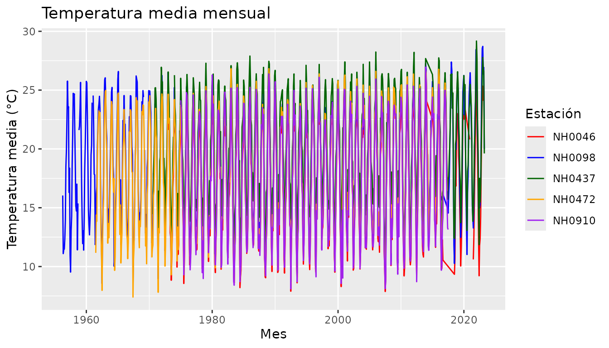

# Cómo usar estacionesmet

``` r

library(estacionesmet)
```

`estacionesmet` es un paquete de práctica para leer y analizar datos de
estaciones meteorológicas del INTA. Esta viñeta muestra cómo usar sus
tres funciones y el dataset que incluye.

## Los datos

El paquete trae el dataset `estaciones`, con datos diarios de cinco
estaciones (NH0472, NH0910, NH0046, NH0098 y NH0437).

``` r

head(estaciones)
#>       id      fecha temperatura_abrigo_150cm temperatura_abrigo_150cm_maxima
#> 1 NH0472 1961-07-01                     11.1                            13.4
#> 2 NH0472 1961-07-02                      5.5                            10.5
#> 3 NH0472 1961-07-03                      6.0                            10.8
#> 4 NH0472 1961-07-04                       NA                              NA
#> 5 NH0472 1961-07-05                     12.4                            14.8
#> 6 NH0472 1961-07-06                     11.0                            16.5
#>   temperatura_abrigo_150cm_minima temperatura_intemperie_5cm_minima
#> 1                             8.8                                NA
#> 2                             0.5                                NA
#> 3                             1.2                                NA
#> 4                             7.0                                NA
#> 5                            10.0                                NA
#> 6                             5.5                                NA
#>   temperatura_intemperie_50cm_minima temperatura_suelo_5cm_media
#> 1                                 NA                          NA
#> 2                                 NA                          NA
#> 3                                 NA                          NA
#> 4                                 NA                          NA
#> 5                                 NA                          NA
#> 6                                 NA                          NA
#>   temperatura_suelo_10cm_media temperatura_inte_5cm
#> 1                           NA                   NA
#> 2                           NA                   NA
#> 3                           NA                   NA
#> 4                           NA                   NA
#> 5                           NA                   NA
#> 6                           NA                   NA
#>   temperatura_intemperie_150cm_minima humedad_suelo precipitacion_pluviometrica
#> 1                                  NA            NA                           0
#> 2                                  NA            NA                           0
#> 3                                  NA            NA                           0
#> 4                                  NA            NA                           0
#> 5                                  NA            NA                           0
#> 6                                  NA            NA                           0
#>   granizo nieve heliofania_efectiva heliofania_relativa tesion_vapor_media
#> 1       0     0                  NA                  NA                9.8
#> 2       0     0                  NA                  NA                7.9
#> 3       0     0                  NA                  NA                7.5
#> 4       0     0                  NA                  NA               14.9
#> 5       0     0                  NA                  NA               17.2
#> 6       0     0                  NA                  NA               11.5
#>   humedad_media humedad_media_8_14_20 rocio_medio duracion_follaje_mojado
#> 1            NA                    81         6.7                      NA
#> 2            NA                    80         3.6                      NA
#> 3            NA                    62         2.9                      NA
#> 4            NA                    93        12.9                      NA
#> 5            NA                    92        15.1                      NA
#> 6            NA                    80         9.0                      NA
#>   velocidad_viento_200cm_media direccion_viento_200cm
#> 1                         14.4                     NA
#> 2                          4.8                     NA
#> 3                          7.2                     NA
#> 4                          8.8                     NA
#> 5                          4.8                     NA
#> 6                         14.4                     NA
#>   velocidad_viento_1000cm_media direccion_viento_1000cm velocidad_viento_maxima
#> 1                            18                    <NA>                      NA
#> 2                             6                    <NA>                      NA
#> 3                             9                    <NA>                      NA
#> 4                            11                    <NA>                      NA
#> 5                             6                    <NA>                      NA
#> 6                            18                    <NA>                      NA
#>   presion_media radiacion_global radiacion_neta evaporacion_tanque
#> 1            NA               NA             NA                 NA
#> 2            NA               NA             NA                 NA
#> 3            NA               NA             NA                 NA
#> 4            NA               NA             NA                 NA
#> 5            NA               NA             NA                 NA
#> 6            NA               NA             NA                 NA
#>   evapotranspiracion_potencial profundidad_napa horas_frio unidad_frio
#> 1                           NA               NA   0.000000          NA
#> 2                           NA               NA  15.600000          NA
#> 3                           NA               NA  14.500000          NA
#> 4                           NA               NA         NA          NA
#> 5                           NA               NA   0.000000          NA
#> 6                           NA               NA   3.272727          NA
```

La columna `id` identifica la estación, `fecha` es el día de la medición
y `temperatura_abrigo_150cm` es la temperatura media a 150 cm.

## Descargar los datos de una estación

[`descargar_estacion()`](https://bautistabusso.github.io/estacionesmet/reference/descargar_estacion.md)
descarga el archivo de una estación y lo lee. Recibe el identificador de
la estación y la ruta donde se guarda el archivo:

``` r

nh0437 <- descargar_estacion("NH0437", "NH0437.csv")
```

El resultado es un tibble con las mediciones de esa estación. Si se
repite para las cinco estaciones y se unen con
[`rbind()`](https://rdrr.io/r/base/cbind.html), se obtiene `estaciones`.

## Tabla resumen de la temperatura

[`tabla_resumen_temperatura()`](https://bautistabusso.github.io/estacionesmet/reference/tabla_resumen_temperatura.md)
calcula la media y el desvío de la temperatura para cada estación. Cada
fila es un estadístico y cada columna una estación:

``` r

tabla_resumen_temperatura(estaciones)
#> # A tibble: 2 × 6
#>   estadistico NH0046 NH0098 NH0437 NH0472 NH0910
#>   <chr>        <dbl>  <dbl>  <dbl>  <dbl>  <dbl>
#> 1 media        17.3   18.6   20.2   18.0   17.7 
#> 2 desvio        5.90   5.98   5.77   5.94   6.12
```

Funciona con una o más estaciones. Por ejemplo, para dos de ellas:

``` r

dos_estaciones <- estaciones[estaciones$id %in% c("NH0437", "NH0046"), ]
tabla_resumen_temperatura(dos_estaciones)
#> # A tibble: 2 × 3
#>   estadistico NH0046 NH0437
#>   <chr>        <dbl>  <dbl>
#> 1 media        17.3   20.2 
#> 2 desvio        5.90   5.77
```

## Gráfico de la temperatura mensual

[`grafico_temperatura_mensual()`](https://bautistabusso.github.io/estacionesmet/reference/grafico_temperatura_mensual.md)
grafica el promedio mensual de la temperatura de cada estación. Hay que
indicar un color por estación en el argumento `colores`, y se puede
cambiar el título con `titulo` (por defecto es “Temperatura”).

``` r

grafico_temperatura_mensual(
  estaciones,
  colores = c("red", "blue", "darkgreen", "orange", "purple"),
  titulo = "Temperatura media mensual"
)
#> Warning: Removed 1 row containing missing values or values outside the scale range
#> (`geom_line()`).
```


